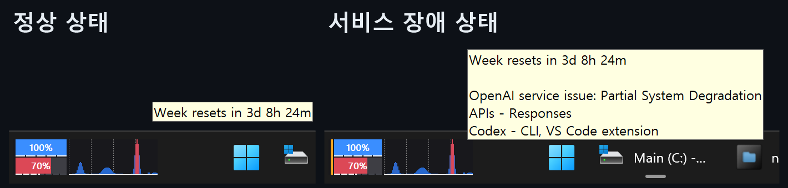
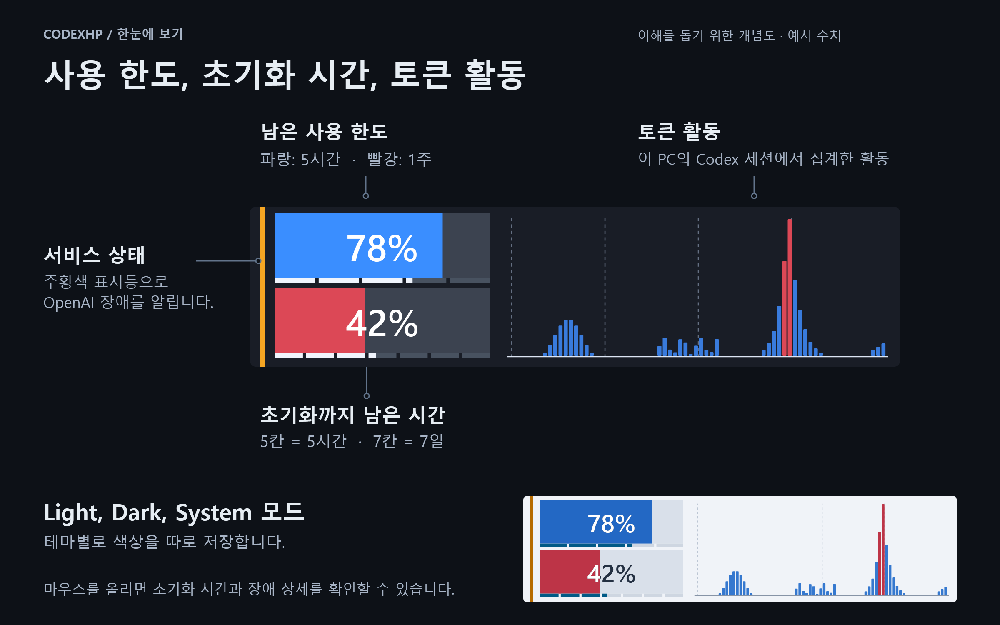
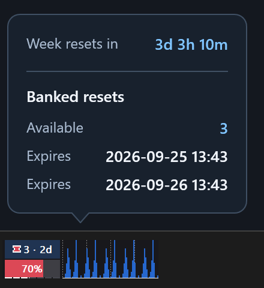
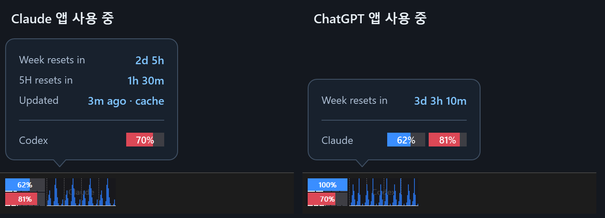
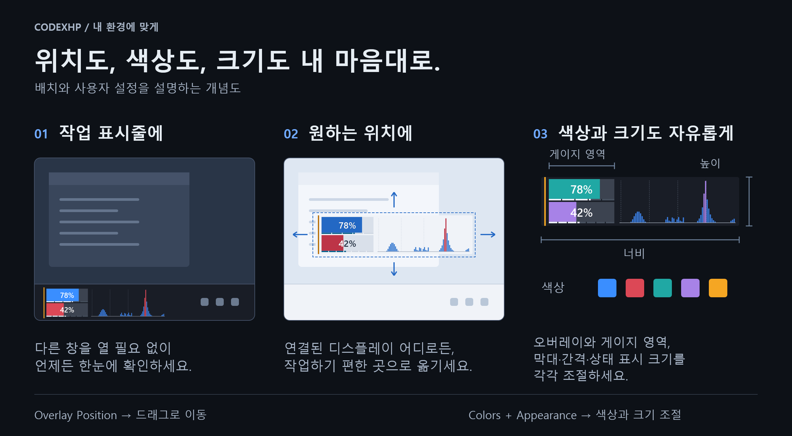

# CodexHp

[English](README.md)

**Windows 11 작업 표시줄에 Codex/Claude 사용 한도와 토큰 활동을 표시합니다.**

이제 Claude도 지원합니다. Claude 데스크톱 앱이 설치되어 있으면 바로 동작합니다. 따로 설정할 것은 없습니다.



- **왼쪽:** 평소 상태. 마우스를 올리면 주간 한도 초기화까지 남은 시간이 보입니다.
- **오른쪽:** OpenAI 서비스 장애 상태. 주황색 줄이 나타나고, 툴팁에 영향받는 서비스가 표시됩니다.

**[최신 릴리스 받기](https://github.com/netics01/CodexHp/releases/latest)** · 미서명, [설치](#설치) 참고

## 표시 내용



- **막대**: 남은 5시간(파랑)·주간(빨강) 한도
- **얇은 게이지**: 초기화까지 남은 시간(시간·일 단위)
- **그래프**: 이 PC 세션의 토큰 활동. 계정 전체 합계는 아님
- **주황색 줄**: 서비스 장애. 마우스를 올리면 영향받는 서비스 표시
- **툴팁**: 초기화까지 남은 시간과 상세 정보

## 초기화권(Banked resets)



상단 막대에 5시간 한도 대신 보유한 초기화권을 표시할 수 있습니다. 위 그림: 3장 보유, 가장 가까운 만료까지 2일.

- 켜기: **Settings → General → Upper bar → Banked resets**
- 표시만 합니다. 초기화권을 사용하지 않습니다. 제공 여부는 계정에 따라 다릅니다.

## Codex와 Claude



- **왼쪽:** Claude 앱을 쓰는 동안에는 Claude를 표시합니다.
- **오른쪽:** ChatGPT 앱을 쓰는 동안에는 Codex를 표시합니다.
- 그래프 안의 연한 글자로 지금 무엇을 보고 있는지 알 수 있습니다.
- 툴팁 마지막 줄에 다른 쪽이 표시됩니다.
- Claude는 항상 5시간 한도를 표시합니다. 그래프는 Claude Code 세션입니다.
- Claude 값은 갱신 없이 30분이 지나면 흐려지고, 2시간이 지나면 숨겨집니다.
- 하나만 표시하려면: **Settings → General → Provider**

## 배치와 모양



1. 작업 표시줄 위
2. 모든 디스플레이의 원하는 위치(**Settings → Overlay Position**에서 드래그)
3. 라이트/다크 테마별 색상, 오버레이와 요소 크기

## 동작

- Windows와 함께 시작(끌 수 있음)
- 항상 표시, 또는 ChatGPT·Claude 실행 중에만 표시
- 같은 모니터에 전체 화면 앱이 있으면 숨김
- 모니터, 작업 표시줄, DPI 변화에 맞춰 위치 보정
- 오버레이 더블클릭 또는 트레이 아이콘으로 설정 열기
- 시작할 때와 매주 GitHub에서 새 버전 확인. 자동으로 내려받거나 설치하지 않음

## 설치

1. [최신 릴리스](https://github.com/netics01/CodexHp/releases/latest)에서 `CodexHp-Setup-<version>-x64.exe`를 내려받습니다.
2. 실행합니다. 현재 사용자용으로 `%LocalAppData%\Programs\CodexHp`에 설치됩니다.

포터블 `CodexHp-Portable-<version>-x64.exe`도 있습니다. 자동 시작을 켜기 전에 다운로드 폴더 밖으로 옮기세요.

> [!WARNING]
> 릴리스는 코드 서명이 없습니다. SmartScreen이나 Smart App Control이 경고하거나 차단할 수 있습니다. 이 저장소에서만 내려받고 `SHA256SUMS.txt`로 확인하세요.
>
> ```powershell
> Get-FileHash .\CodexHp-Setup-<version>-x64.exe -Algorithm SHA256
> ```

### 요구 사항

- Windows 11 빌드 22000 이상(x64)
- 로그인되어 Codex를 쓸 수 있는 ChatGPT 데스크톱 앱
- 선택: 로그인된 Claude 데스크톱 앱

Claude 한도는 Claude 데스크톱 앱에서만 읽습니다. 브라우저, CLI, 편집기에서만 Claude를 쓰면 표시되지 않습니다.

## 데이터와 개인정보

- **Codex**: 기존 Codex 로그인 캐시(`%CODEX_HOME%\auth.json` 또는 `%USERPROFILE%\.codex\auth.json`)를 읽고, `chatgpt.com`에 사용량을 요청할 때만 씁니다.
- **Claude**: Claude 데스크톱 앱의 사용량 기록과 캐시된 사용량 응답을 읽습니다. Claude 로그인 토큰이나 쿠키는 읽지 않고, Claude에 요청을 보내지 않습니다.
- **그래프**: 로컬 Codex·Claude Code 세션 로그
- **그 외 요청**: 공개 상태 페이지(`status.openai.com`, `status.claude.com`)와 GitHub 릴리스
- 로그인하지 않고, 토큰을 설정이나 로그에 저장하지 않으며, 개발자 서버로 보내지 않습니다.
- 공개되지 않은 엔드포인트와 앱 파일에 의존하므로 예고 없이 동작하지 않을 수 있습니다.

## 왜 "HP"인가요?

게임의 체력 게이지처럼, 남은 한도를 보여 줍니다.

## 소스에서 빌드

`global.json`에 고정된 .NET 10 SDK가 필요합니다. Inno Setup 6은 설치 프로그램 빌드에만 필요합니다.

```powershell
pwsh -NoProfile -File .\scripts\Verify-Core.ps1
.\out\win-x64\CodexHp.exe
```

- 결과물은 `out\win-x64`에 생깁니다(Git 추적 안 함). 실행 중인 CodexHp를 먼저 종료하세요.
- 설치 프로그램: `pwsh -NoProfile -File .\scripts\Build-Installer.ps1` → `out\installer`
- 로컬 빌드는 About에 **CodexHp-Dev**로 표시됩니다.
- 개발 빌드에는 [시뮬레이션 도구](docs/development-simulation.md)가 들어 있습니다.
- 공식 릴리스 자산은 `pwsh -NoProfile -File .\scripts\Publish-LocalRelease.ps1 -AllowUnsignedRelease`로만 만듭니다.

## 프로젝트 상태

비공식 초기 단계 프로젝트입니다. OpenAI나 Anthropic과 제휴·보증·지원 관계가 없습니다. ChatGPT, Codex, Claude, Windows가 바뀌면 일부 기능이 동작하지 않을 수 있습니다.

## 피드백

아이디어나 문제가 있으면 [이슈를 등록해 주세요](https://github.com/netics01/codexhp/issues).

## 라이선스

[Apache License, Version 2.0](LICENSE)
