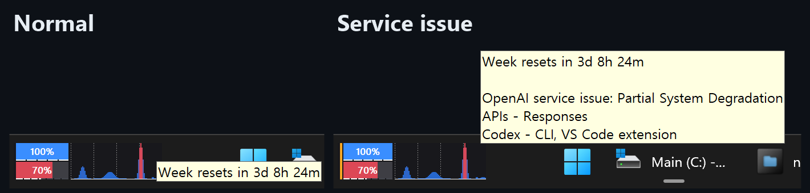
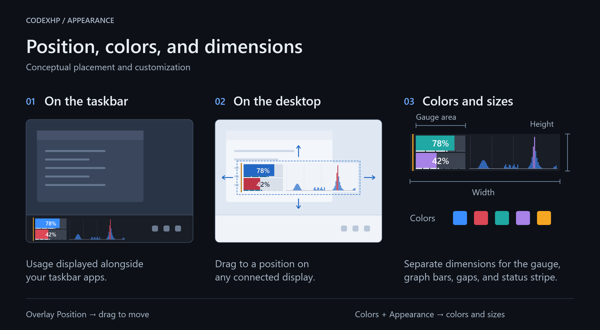

# CodexHp

[한국어](README.ko.md)

**Codex/Claude usage limits and token activity on the Windows 11 taskbar.**

Now supports Claude too. If the Claude desktop app is installed, it just works. No setup required.



- **Left:** normal. Hover to see when the weekly limit resets.
- **Right:** an OpenAI service issue. An orange stripe appears, and the tooltip lists the affected services.

**[Get the latest release](https://github.com/netics01/CodexHp/releases/latest)** · unsigned, see [Install](#install)

## What it shows


- **Bars**: remaining 5-hour (blue) and weekly (red) limits
- **Thin gauges**: time until reset, in hours and days
- **Graph**: token activity from sessions on this PC[^graph]
- **Orange stripe**: service issue; hover for affected services
- **Tooltip**: reset countdowns and details

## Banked resets


The upper bar can show your banked resets instead of the 5-hour limit. Above: 3 credits, the next one expires in 2 days.[^banked]

- Turn on: **Settings → General → Upper bar → Banked resets**

## Codex and Claude


- **Left:** while you use the Claude app, the overlay shows Claude.
- **Right:** while you use the ChatGPT app, it shows Codex.
- The faint label in the graph tells you which one you are looking at.
- The last tooltip row shows the other one.
- Claude always shows the 5-hour limit. The graph shows Claude Code sessions.[^claude-values]
- To show only one: **Settings → General → Provider**

## Placement and appearance



1. On the taskbar
2. Anywhere on any display (**Settings → Overlay Position**, then drag)
3. Colors per Light/Dark theme, overlay and element sizes

## Behavior

- Starts with Windows (can be turned off)
- Always visible, or only while ChatGPT or Claude is running
- Hides when a full-screen app is on the same monitor
- Adjusts to monitor, taskbar, and DPI changes
- Double-click the overlay or the tray icon for settings
- Checks GitHub for updates at startup and weekly; never downloads or installs on its own

## Install

1. Download `CodexHp-Setup-<version>-x64.exe` from the [latest release](https://github.com/netics01/CodexHp/releases/latest).
2. Run it. It installs per user under `%LocalAppData%\Programs\CodexHp`.

A portable `CodexHp-Portable-<version>-x64.exe` is also available. Move it out of Downloads before enabling startup.

> [!WARNING]
> Releases are not code-signed. SmartScreen or Smart App Control may warn or block. Download only from this repository and check `SHA256SUMS.txt`:
>
> ```powershell
> Get-FileHash .\CodexHp-Setup-<version>-x64.exe -Algorithm SHA256
> ```

### Requirements

- Windows 11 build 22000 or later (x64)
- ChatGPT desktop app, signed in with Codex access
- Optional: Claude desktop app, signed in[^claude-app]

## Data and privacy

- **Codex**: reads the existing Codex sign-in cache (`%CODEX_HOME%\auth.json` or `%USERPROFILE%\.codex\auth.json`) and uses it only to request usage from `chatgpt.com`.
- **Claude**: reads the Claude desktop app's usage history and its cached usage response. Never reads Claude sign-in tokens or cookies, and sends no requests to Claude.
- **Graphs**: local Codex and Claude Code session logs.
- **Other requests**: public status pages (`status.openai.com`, `status.claude.com`) and GitHub releases.
- No sign-in, no tokens in settings or logs, no developer server.
- Relies on non-public endpoints and app files that may change without notice.

## Why "HP"?

Like a health bar in a game: how much of your limit is left.

## Build from source

Requires the .NET 10 SDK pinned in `global.json`. Inno Setup 6 only for the installer.

```powershell
pwsh -NoProfile -File .\scripts\Verify-Core.ps1
.\out\win-x64\CodexHp.exe
```

- Output goes to `out\win-x64` (untracked). Exit a running CodexHp first.
- Installer: `pwsh -NoProfile -File .\scripts\Build-Installer.ps1` → `out\installer`
- Local builds show **CodexHp-Dev** in About.
- Development builds include a [simulation tool](docs/development-simulation.md).
- Official release assets are built only with `pwsh -NoProfile -File .\scripts\Publish-LocalRelease.ps1 -AllowUnsignedRelease`.

## Project status

Unofficial and early-stage. Not affiliated with, endorsed by, or supported by OpenAI or Anthropic. Changes to ChatGPT, Codex, Claude, or Windows may break features.

## Feedback

Ideas or problems? [Open an issue](https://github.com/netics01/codexhp/issues).

## License

[Apache License, Version 2.0](LICENSE)

[^graph]: Not an account-wide usage or billing total.
[^banked]: Display only. CodexHp does not redeem credits. Availability depends on your account.
[^claude-values]: Claude values come from the Claude desktop app. They dim after 30 minutes and are hidden after 2 hours without an update.
[^claude-app]: Claude limits come only from the Claude desktop app. Using Claude only in a browser, the CLI, or an editor is not enough.
