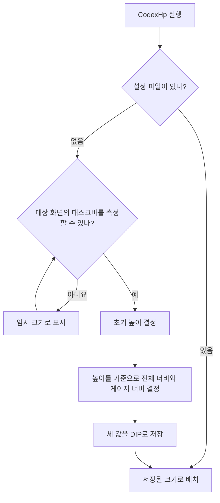
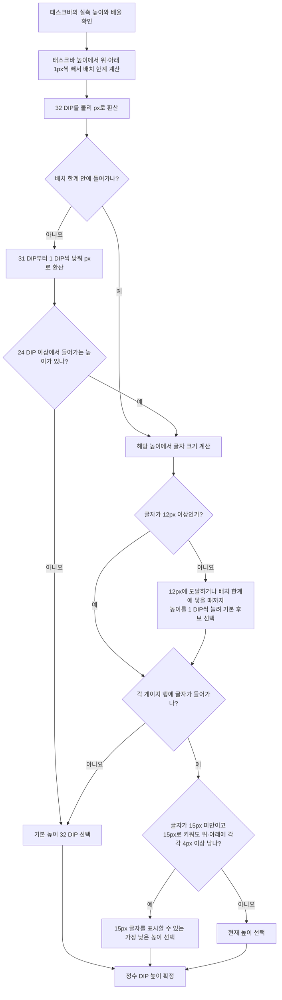
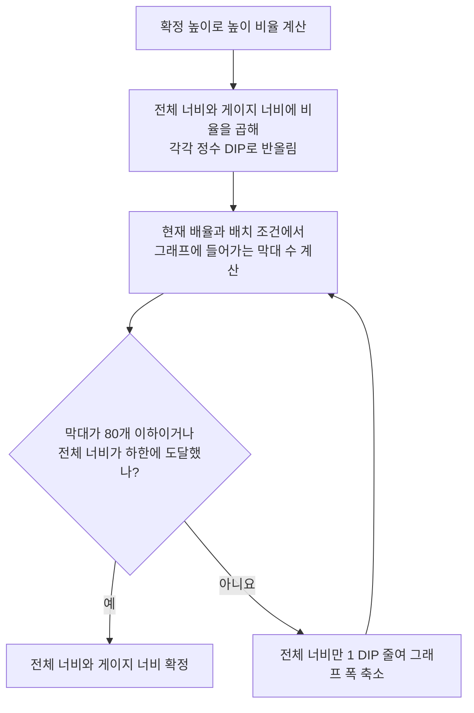
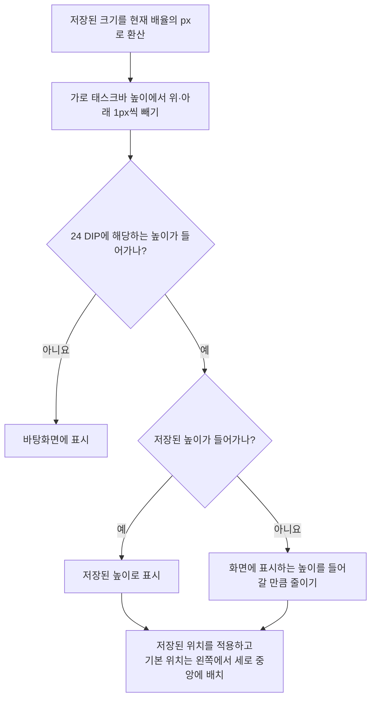

# CodexHp 초기 크기 결정 정책

**정식 정책**

CodexHp는 최초 실행에서 오버레이 높이를 먼저 정하고, 그 높이에 맞춰 전체 너비와 게이지 너비를 고른다. 세 값은 **DIP**(논리 픽셀)로 저장한다. 화면에 표시할 때는 각 값에 Windows 배율을 곱한 뒤 반올림해 **px**(물리 픽셀)로 변환한다. 예를 들어 `37 DIP`는 150%에서 `56px`가 된다.

## 전체 흐름

태스크바가 늦게 준비되면 임시 크기로 시작하고, 설정이 저장되기 전까지 첫 측정을 기다린다. 사용자가 먼저 Settings에서 설정을 저장하면 그때 저장된 크기를 사용한다. 높이와 너비는 **Settings → Appearance**에서 직접 조절할 수 있다. [최초 설정 저장](../src/CodexHp.App/Infrastructure/JsonSettingsStore.cs)

## 초기 높이 결정

가로 태스크바에서 `32 DIP`를 첫 높이 후보로 사용한다. 후보의 물리 높이가 **태스크바 높이 − 2px** 이하면 위·아래에 최소 `1px`씩 남길 수 있다. 각 후보의 글자 크기는 리프레시 줄과 간격을 제외한 게이지 행 높이로 계산하며, `8.5 DIP` 하한을 적용한다.

150%에서 태스크바가 `48px`이면 배치 한계는 `46px`이다. `32 DIP → 48px`, `31 DIP → 47px`, `30 DIP → 45px` 순으로 확인해 `30 DIP`부터 글자 크기를 검사한다. 세로 태스크바에서는 기본 높이 `32 DIP`를 선택한다. [높이 선택과 배치](../src/CodexHp.Core/Positioning/OverlayDisplayResolver.cs) · [게이지 글자 크기 계산](../src/CodexHp.Core/Settings/OverlayPixelPolicy.cs)

## 초기 너비 결정

**높이 비율**은 앞에서 정한 높이를 기준 높이 `32 DIP`로 나눈 값이다. 이 비율을 기준 전체 너비 `130 DIP`와 기준 게이지 너비 `48 DIP`에 각각 곱하고 정수 DIP로 반올림한다. 활동 그래프는 막대 하나가 15초를 나타낸다.

- **20분은 최초 표시 범위의 상한**이다. 80개 이하가 들어가면 비례 계산한 너비를 사용한다. 예를 들어 150%에서 전체 너비 `150 DIP`, 게이지 너비 `56 DIP`를 사용하면 `17분 15초`가 표시된다.
- 너비를 줄일 때는 저장 가능한 최소 너비 `68 DIP`와 **선택한 게이지 너비 + 그래프 공간 `20 DIP`** 중 큰 값을 하한으로 쓴다. 125%에서는 전체 너비 `118 DIP`에 `20분 15초`가 들어가므로 `117 DIP`를 선택해 `19분 45초`를 표시한다.
- **Visible token history**는 현재 화면에 들어가는 막대 수를 시간으로 환산해 표시한다. 사용자가 크기를 바꾸거나 다른 배율의 화면으로 이동하면 이 값도 달라질 수 있다.

[초기 너비 선택](../src/CodexHp.App/Application/DefaultAppearanceFactory.cs) · [크기 검증](../src/CodexHp.Core/Settings/SettingsValidator.cs) · [막대 수 계산](../src/CodexHp.Core/Domain/TokenGraphViewport.cs)

## 저장 후 배치

예를 들어 100%에서 태스크바가 `42px`이면 저장된 `44 DIP` 높이는 화면에서 `40px`로 표시된다. 설정에는 `44 DIP`가 남으므로 공간이 충분해지면 다시 `44px`로 보인다. **Reset to Defaults**는 높이를 `32 DIP`로 되돌리고 현재 화면에서 약 20분을 표시할 너비를 고른다.

## 적용 예시

| 배율 · 태스크바 높이 | 저장 높이 | 저장 전체 너비 | 저장 게이지 너비 | 표시 너비 × 높이 | 활동 그래프 |
|---|---:|---:|---:|---:|---:|
| 100% · 42px | 40 DIP | 142 DIP | 60 DIP | 142 × 40px | 20분 |
| 100% · 48px | 43 DIP | 147 DIP | 65 DIP | 147 × 43px | 20분 |
| 125% · 60px | 34 DIP | 117 DIP | 51 DIP | 146 × 43px | 19분 45초 |
| 150% · 63px | 32 DIP | 130 DIP | 48 DIP | 195 × 48px | 15분 |
| 150% · 64px | 37 DIP | 150 DIP | 56 DIP | 225 × 56px | 17분 15초 |
| 150% · 72px | 37 DIP | 150 DIP | 56 DIP | 225 × 56px | 17분 15초 |
| 175% · 84px | 32 DIP | 130 DIP | 48 DIP | 228 × 56px | 17분 30초 |
| 200% · 96px | 32 DIP | 130 DIP | 48 DIP | 260 × 64px | 20분 |
